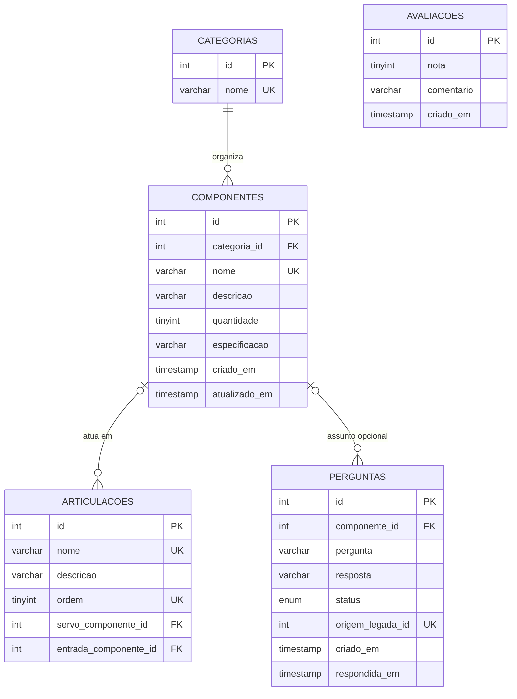

# Modelo lógico — Braço Robótico

## Diagrama entidade-relacionamento

## Por que o banco é mais útil agora

O banco alimenta conteúdo que muda durante a feira: o catálogo pode ser atualizado, perguntas reais podem ser recebidas e respondidas, e a equipe pode acompanhar a avaliação do público. Não é necessário cadastrar visitantes com nome, e-mail ou instituição para usar essas funções.

## Tabelas

- `categorias`: grupos do catálogo.
- `componentes`: peças, função, quantidade e especificação complementar.
- `articulacoes`: os quatro movimentos — base, ombro, cotovelo e garra — relacionados a um servomotor e a um potenciômetro.
- `perguntas`: texto recebido, componente opcional, resposta e estado (`pendente`/`publicada`). Só perguntas respondidas e publicadas são mostradas no site.
- `avaliacoes`: nota de 1 a 5 e comentário opcional, sem dados pessoais ou IP.

## Integridade

- `categorias → componentes`: 1:N; `RESTRICT` evita remover categoria ainda utilizada.
- `componentes → articulacoes`: 1:N opcional em cada referência; `SET NULL` preserva a descrição do eixo se uma peça for removida.
- `componentes → perguntas`: 1:N opcional; `SET NULL` mantém a pergunta como geral após excluir uma peça.
- `quantidade`: valor entre 1 e 99.
- `pergunta`: de 5 a 500 caracteres.
- `nota`: valor entre 1 e 5.

## Normalização

Os nomes das categorias e componentes ficam em suas próprias tabelas. As articulações e perguntas guardam chaves estrangeiras, evitando repetir descrições de peças. As avaliações são independentes e não dependem de uma identidade de visitante.
